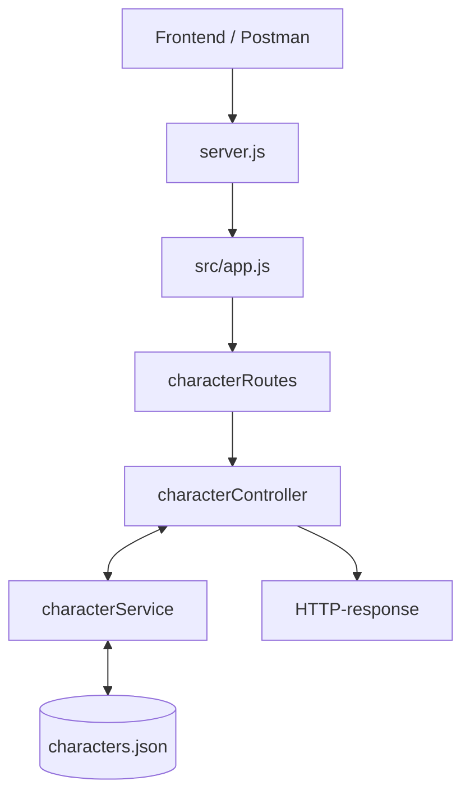

# Feedback – Star Wars API 

### Hvor skal HTTP-requests håndteres?:
Middleware -> Routes -> Controller-> Service

▫	Middleware: Kontrollere sikkerhedsregler og validering samt om formatere anmodningen hvis det er nødvendigt.

▫	Routes: Sørger for at bruge den pågældende service ud fra den modtagne request samt returnere et respons til client (/get, /post osv.).

▫	Controllers: modtager requesten og kalder de relevante services

▫	Service: håndtere forretningslogikken 

### Hvor skal karakterdata gemmes?: 
Det gemmes i en json-fil som ligger i /data

### Hvor skal valideringen placeres?: 
Det gør vi i middleware

### Hvad er fordelene ved jeres valgte arkitektur?: 
Den gør det nemt at holde overblik af den opdelte kode igennem den vigtige ansvarsopdeling mellem gruppemedlemmerne. Den laverer kobling der er mellem de forskellige moduler er helt sikkert også en fordel ved arkitekturerne.

## Opdeling:

### Opstart af server
For at bruge programmet, skal man starte servern i server.js. Derefter kan man bruge ens webbrowser til at tilgå server i http://localhost:3000 hvor man ville få vist de forskellige funktioner dette program udgiver.

### Arkitektur og ansvar
Til vores projekt har vi valgt at bygge strukturen op med Model-View-Controller (MVC):
projektmappe/
├── files/              # statiske filer (fx .txt)
├── src/
│   ├── controllers/     # forretningslogik i Service
│   ├── routes/          # ruter
│   ├── public/           # HTML-filer
│   ├── middleware/      # logning, validering
│   ├── data/      # værdier der gemmes, modeller
│   └── app.js           # Express-app
├── server.js            # starter serveren
└── package.json         # dependencies

Vi har valgt at gå med MVC modellen da vi tidligere har anvendt den, samt giver det også en god ansvarsopdeling så man kan nemt danne sig et overblik og opdele koden som giver en lav kobling mellem modulerne.

## Fordele og ulemper ved arkitekturen

### Fordele:

•	Ansvaret bliver fordelt på de forskellige lag

•	Det er nemmere at finde fejl de enkelte steder ved at ansvaret er fordelt.

•	Bedre overblik over projektet

### Ulemper:

•	Det tager lidt længere tid at opsætte projektet især med at forbinde modulerne

•	Flere filer at skulle holde styr på

Mermaid-diagram

## Beskrivelse:
•	Frontend/Postman er det som brugeren får vist eller hvad vi får vist når vi kører serveren med Postman

•	server.js starter serveren

•	src/app.js konfigurerer express, middleware og routes

•	characterRoutes bestemmer hvilken controllerfunktion der skal håndtere requesten

•	characterController modtager requesten, kalder service og tilbagesender et response

•	characterService står for forretningslogikken

•	characters.json repræsenterer de gemte karakter-data

•	Til sidst et http-response der bliver sendt

### Endpoints
I dette project har vi 7 endpoints som set i vores ’characterRoutes.js’. Hver endpoint har hver sin egen opgave:

GET(”/characters”) – Henter alle karaktererne

GET(“/characters/:id”) – Henter en bestemt karakter ud fra deres id

POST(“/characters”) – Opretter en ny karakter

PUT(“/characters/:id”) – Erstater en nuværende karakter en ny information

DELETE(“/characters/:id”) – Sletter en nuværende karakter 

GET(“/download”) – Henter en txt-fil

GET(“/go-to-luke”) – Omdiregerer til et andet endpoint, her er det til en bestemt karakter, derfor ”/characters/:id”

## Test
Tests er blevet gennemført ved brug af Postman for at se at de enkelte funktioner fungerer som de skal og hvis der sker fejl, sender den relevante fejlbesked og statuskode tilbage.

Tabel med test:
| Test        | Status   | Resultat |
| ------------- |:-------------:|:-------------:|
| Hent alle karakterer   | 200 | Karaktererne blev hentet | 
| Hent eksisterende karakter   | 200      | Den enkelte karakter blev hentet      |
| Hent ukendt karakter | 404  | Fejlbesked: Karakter ikke fundet  |
| Opret gyldig karakter | 201  | Karakter bliver oprettet   |
| Opret karakter uden navn | 400  | Fejlbesked:   name skal indholde mindst 2 tegn, og må ikke indholde tal |
| Opret karakter med ugyldig rolle | 400  | Fejlbesked: role skal være Jedi, Sith, Rebel eller Smuggler |
| Opret karakter uden planet | 400  | Fejlbesked: homeworld må ikke være tomt|
| Opdater eksisterende karakter | 200  | Karakter bliver opdateret   |
| Opdater ukendt karakter | 404  | Fejlbesked:  Karakter ikke fundet  |
| Slet eksisterende karakter | 204  | Karakter bliver slettet  |
| Slet ukendt karakter | 404  | Fejlbesked:   Karakter ikke fundet|

## AI-Agent
Vi har brugt Copilot til at hjælpe os med at opdele opgaven ind i issues som vi har kunne dele ud i gruppen. Samt har vi udnyttede den i form af Reviews.
F.eks. hjalp den til rettelsen af validering og fejlhåndtering, da flere af os lavet en smule validering for os selv i de individuelle branches som så skulle køre igennem middleware i stedet.

## Refleksion
### • Hvad ville I ændre, hvis applikationen skulle anvendes af mange brugere? 
#### Database: Der skulle tilkobles en ordentlig database på applikationen i stedet for at gemme dem i en JSON-fil.
#### Login/rettigheder: tilføje login og admin så ikke alle kan redigere i data’en.
#### Sider og søgefunktion: sider så vi limiter mængden af karakterer der sendes af gangen og søgefunktion så man kan finde rundt bedre. 
### •	Hvilke fejl fandt I under udvikling og test? 
En af fejlene vi fandt, var til redirect, som vi havde sat til at gå hen til ”/characters/1” hvilket var Lukes id til at starte med, men da vi ændrede vores gemte karakterer fra at være et array gemt i service, til data gemt i en json-fil, ændrede det Lukes data til et crypto.randomUUID genereret id. Hvis vi dog slettede Luke og oprettede ham igen, ville han få et nyt id som vi derfra skulle ændre redirecten igen. For at løse dette kunne vi tilføje en metode der fandt id’et ud fra karakterens navn, men da det er et mindre projekt, har vi valgt at fravælge dette.
### •	Hvilken forbedring gennemførte I efter kode-review? 
Efter vores kode var blevet review’et af AI, pointerede den nogle punkter som vi ikke selv havde lagt mærke til, heriblandt refaktorering af CRUD (pull request 11):

-	”await createCharacter before sending the response” – Hvilket gjorde så vi sikrede os at karakteren blev lavet før responset blev sendt.

-	”return the created character after writing it” – Hvor vi førhen sendte den forkerte værdi tilbage, så vi fik rettede det til at den sendte den korrekte karakter-værdi som response

-	”signal missing characters and return 404 on delete” – Vi sendte error-beskeden tilbage på en forkert måde. Dette rettede vi i senere issue som  ”validering”

### • Hvad lærte I om samspillet mellem frontend og backend?
#### • Dette har været med til at vise os hvilke roller frontend og backend har. Frontenden står for at vise det til brugeren der skal vises, samt få sendt requesten og modtage responsen og vise det relevante på hjemmesiden. Backenden står derimod for logikken, håndtering af de forskellige requests samt validering og få sendt de relevante respons tilbage.
#### •	Samspillet kan ses I at de hver har deres ansvar for at få programmet til at kunne fungere, backend som kerne i at få det til at fungere og frontend for at få det hele ind i lyset. 

